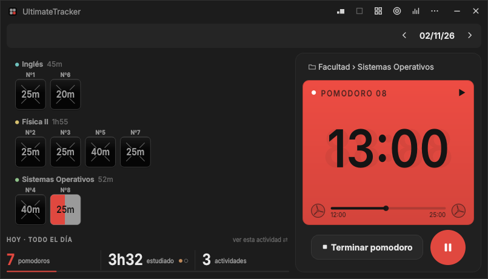

# UltimateTracker

Pomodoros y horas de estudio en una ventana chica: cada pomodoro es un cuadradito que se llena, y la app cuenta tus horas por materia camino a las 10.000.

## Instalar

1. Bajá el último **`UltimateTracker-…-setup.exe`** desde [Releases](https://github.com/LucaSalviani/UltimateTracker/releases) y abrilo.
2. Si aparece **"Windows protegió tu PC"**: **Más información → Ejecutar de todas formas** (la beta no está firmada).

Windows 10 y 11 de 64 bits. No pide permisos de administrador. También hay una versión portable en `.zip`.

## Uso básico

- **⋯ → Actividades:** creá tus materias.
- **Espacio:** arranca o pausa el pomodoro. Al terminar elegís recreo o seguir.
- **G:** objetivo del día. **S:** estadísticas. **?:** todos los atajos.
- **⋯ → Ajustes:** temas, estilos, sonidos y hitos. En *Sistema* podés hacer que arranque con Windows y te salude al empezar el día.

Tus datos quedan en tu compu (`%APPDATA%\UltimateTracker`). Para desinstalar: *Configuración → Aplicaciones*.

📖 [Manual completo](docs/MANUAL.md) · 🐞 [Reportar un error](https://github.com/LucaSalviani/UltimateTracker/issues)
