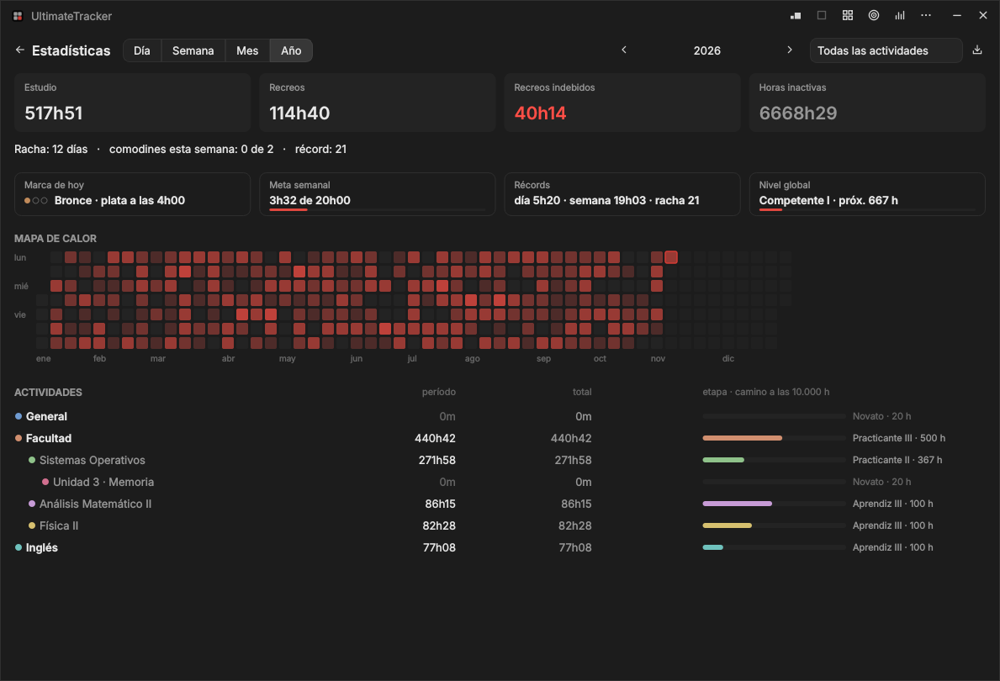
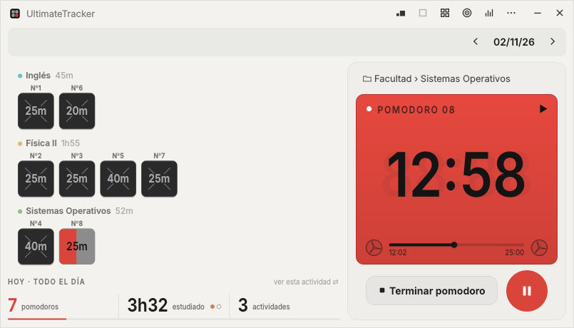

# UltimateTracker

**Pomodoros y horas de estudio, en una ventana chica.** Cada pomodoro es un cuadradito que se va llenando mientras estudiás. La app cuenta tus horas por materia como el contador de horas de un videojuego y te acompaña camino a las 10.000 horas.

## Descargar

1. Entrá a [**Releases**](https://github.com/LucaSalviani/UltimateTracker/releases) y bajá el último **`UltimateTracker-…-setup.exe`**.
2. Abrilo y seguí el instalador. Se instala solo para tu usuario, no pide permisos de administrador y te deja un acceso directo en el escritorio.
3. Si Windows muestra **"Windows protegió tu PC"**, tocá **Más información → Ejecutar de todas formas**. Aparece porque la app todavía no está firmada; es normal en una beta.

> Funciona en **Windows 10 y 11 (64 bits)**. Si preferís no instalar nada, en el mismo lugar está la versión portable en `.zip`: descomprimila y abrí `UltimateTracker.exe`.

## Primeros pasos

1. **Creá tus actividades.** En el menú **⋯ → Actividades** agregá tus materias o temas (por ejemplo *Facultad → Física II*). Podés anidarlas y elegirles un color.
2. **Elegí la actividad y la duración.** Arriba del cronómetro elegís en qué vas a trabajar. La duración se cambia con los botones **− / +**, con la rueda del mouse o haciendo click en el tiempo para escribirla.
3. **Dale play** (o apretá **Espacio**). El cuadradito se va llenando. Cuando termina suena un aviso y elegís si tomarte un recreo, y de cuánto, o seguir con otro pomodoro.
4. **Mirá cómo venís.** Abajo de la grilla ves los pomodoros y el tiempo de hoy. En **Estadísticas** (el ícono de barras) tenés el día, la semana, el mes y el año.

## Lo que trae

- **Pomodoros a tu medida:** la duración que quieras, y cada uno arranca cuando vos le das play.
- **Recreos con alarma.** El tiempo muerto entre un pomodoro y otro, sin recreo ni estudio, se anota aparte como "recreo indebido" para que lo veas.
- **Objetivo del día:** decí qué querés lograr hoy (tecla **G**) y la grilla te muestra lo que falta. Se puede repetir todos los días o algunos días de la semana.
- **Estadísticas** por día, semana, mes y año, con mapa de calor, rachas y la opción de exportar todo a Excel (CSV).
- **Hitos para motivarte:**
  - *Todos los días:* marca de bronce, plata y oro según las horas, rachas y récords personales.
  - *Cada semana:* una meta de horas que se va llenando abajo de la grilla.
  - *A largo plazo:* etapas por materia camino a las 10.000 h, de **Novato** a **Maestro**, y un nivel global con todo lo que estudiaste.
- **Siempre a mano:** ventana chica para tener al costado, mini reproductor flotante (**M**), modo pantalla completa (**F11**) y la opción de esconderla contra el borde de la pantalla.
- **A tu gusto:** temas oscuro y claro en varios colores, distintos estilos de cuadraditos, festejos y sonidos. Todo se cambia en **⋯ → Ajustes**.

## Atajos de teclado

| Tecla | Qué hace |
|---|---|
| **Espacio** | Play / pausa |
| **← →** | Día anterior / siguiente |
| **T** | Volver a hoy |
| **G** | Objetivo del día |
| **S** | Estadísticas |
| **M** | Mini reproductor |
| **Ctrl + Z** | Deshacer lo último |
| **Ctrl + Alt + P** | Pausar o seguir desde cualquier programa |
| **?** | Ver todos los atajos |

## Preguntas frecuentes

**¿Dónde se guardan mis datos?**
En tu compu, en `%APPDATA%\UltimateTracker`. No se suben a ningún lado. La app hace una copia de seguridad todos los días y guarda las últimas 7.

**¿Puedo cargar las horas que estudié antes de usar la app?**
Sí: en **Actividades**, click derecho sobre la materia → **Horas previas…**. Cuentan para el total, los hitos y las etapas.

**Me equivoqué con un pomodoro, ¿lo puedo corregir?**
Sí: click derecho sobre el cuadradito para moverlo a otra actividad, corregir cuánto duró, agregarle una nota o borrarlo. Casi todo se puede deshacer con **Ctrl + Z**.

**No quiero que arranque con Windows.**
Viene prendido. Se apaga en **⋯ → Ajustes → Sistema → Iniciar con Windows**.

**¿Cómo la desinstalo?**
En **Configuración → Aplicaciones → Aplicaciones instaladas → UltimateTracker**. Te pregunta si querés borrar también tus datos.

## Comentarios y errores

Es una beta: si algo no anda o se te ocurre una mejora, [abrí un issue](https://github.com/LucaSalviani/UltimateTracker/issues) o escribime.

---

Hecha en C++ y Qt, nativa para Windows. Si querés compilarla o modificarla, mirá la [guía de desarrollo](docs/DESARROLLO.md).
