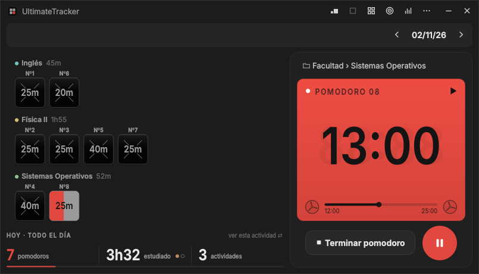
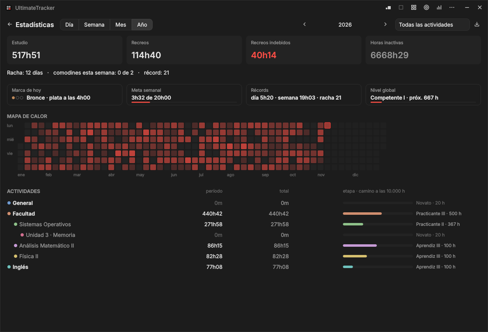
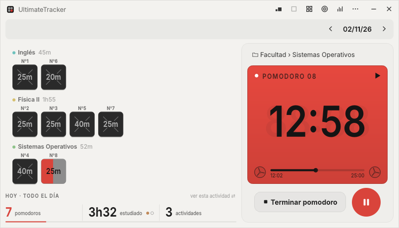

# Manual de UltimateTracker

**Pomodoros y horas de estudio, en una ventana chica.** Cada pomodoro es un cuadradito que se va llenando mientras estudiás. La app cuenta tus horas por materia como el contador de horas de un videojuego y te acompaña camino a las 10.000 horas.

## Descargar

1. Entrá a [**Releases**](https://github.com/LucaSalviani/UltimateTracker/releases) y bajá el último **`UltimateTracker-…-setup.exe`**.
2. Abrilo y seguí el instalador. Se instala solo para tu usuario, no pide permisos de administrador y te deja un acceso directo en el escritorio.
3. Si Windows muestra **"Windows protegió tu PC"**, tocá **Más información → Ejecutar de todas formas**. Aparece porque la app todavía no está firmada; es normal en una beta.

> Funciona en **Windows 10 y 11 (64 bits)**. Si preferís no instalar nada, en el mismo lugar está la versión portable en `.zip`: descomprimila y abrí `UltimateTracker.exe`.

## Primeros pasos

1. **Creá tus actividades.** En el menú **⋯ → Actividades** agregá tus materias o temas (por ejemplo *Facultad → Física II*). Podés anidarlas y elegirles un color.
2. **Elegí la actividad y la duración.** Arriba del cronómetro elegís en qué vas a trabajar. La duración se cambia con los botones **− / +**, con la rueda del mouse o haciendo click en el tiempo para escribirla.
3. **Dale play** (o apretá **Espacio**). El cuadradito se va llenando. Cuando termina suena un aviso y elegís si tomarte un recreo, y de cuánto, o seguir con otro pomodoro.
4. **Mirá cómo venís.** Abajo de la grilla ves los pomodoros y el tiempo de hoy. En **Estadísticas** (el ícono de barras) tenés el día, la semana, el mes y el año.

## Lo que trae

- **Pomodoros a tu medida:** la duración que quieras, y cada uno arranca cuando vos le das play.
- **Recreos con alarma.** El tiempo muerto entre un pomodoro y otro, sin recreo ni estudio, se anota aparte como "recreo indebido" para que lo veas. Cuando terminás de estudiar, **Me voy** (debajo del reloj) cierra la sesión y lo que sigue no cuenta como recreo indebido.
- **Objetivo del día:** decí qué querés lograr hoy (tecla **G**) y la grilla te muestra lo que falta. Te dice cuánto es de estudio y cuánto con los recreos. Se puede repetir todos los días o algunos días de la semana.
- **Tarjeta del día:** la primera vez que abrís la app en el día, cómo te fue ayer, tu racha, los comodines que te quedan y con qué actividad arrancás.
- **Estadísticas** por día, semana, mes y año, con mapa de calor, rachas y la opción de exportar todo a Excel (CSV).
- **Hitos para motivarte:**
  - *Todos los días:* marca de bronce, plata y oro según las horas, rachas y récords personales.
  - *Cada semana:* una meta de horas que se va llenando abajo de la grilla.
  - *A largo plazo:* etapas por materia camino a las 10.000 h, de **Novato** a **Maestro**, y un nivel global con todo lo que estudiaste.
- **Siempre a mano:** ventana chica para tener al costado, mini reproductor flotante (**M**), modo pantalla completa (**F11**) y la opción de esconderla contra el borde de la pantalla.
- **A tu gusto:** temas oscuro y claro en varios colores, distintos estilos de cuadraditos, festejos y sonidos. Todo se cambia en **⋯ → Ajustes**.

### Novedades de la beta 6
- **Anotador**: en el panel Objetivo, botón *Anotador*. Una hoja libre por día para lo que querés hacer y cómo te fue, con tu ánimo de 1 a 5. Si te molesta, apagalo en Ajustes › General y vuelve el diario de antes.
- Al tocar **Me voy**, la app te pregunta cómo te fue.
- **Estadísticas más tranquilas**: el detalle de cada dato aparece solo al hacer click (nada de carteles al pasar el mouse) y hay vista **Simple** (por defecto) o **Avanzada** (suma la línea de promedio y más datos). El botón **ⓘ** vuelve a activar la info al pasar el mouse.
- **Ajustes ordenados** en grupos, con lo avanzado plegado.

### Novedades de la beta 5
- **Marcar un pomodoro a mano**: click derecho en el cuadradito › *Marcar como hecho*. Cuenta igual y queda con un triangulito de "manual".
- **Pausar el recreo**: el tiempo en pausa cuenta como recreo indebido.
- **Objetivo en minutos**: los cuadraditos fantasma se ajustan a lo que te falta; el recreo guardado se borra al tomar un recreo.
- **Mapa de calor nuevo** (horas, pomodoros, objetivo, indebido, inactivo) y gráfico del mes con letras y detalle al pasar el mouse.
- **Evolución**: pestaña nueva en Estadísticas con tendencia, recreo indebido, horas inactivas, metas semanales y ánimo.
- **Diario del día**: en Objetivo, una nota y cómo te va hoy (1–5). El historial de metas semanales empieza desde esta versión.
- Festejo al romper un récord.

### Novedades de la beta 13
- **Evolución › Cuándo estudiás**: mapa de calor con los **días de la semana** (filas) y la **hora del reloj** (columnas, empezando en la hora de inicio del día). Cuanto más rojo, más estudiaste en esa franja; a la derecha, el promedio por día de cada día de la semana. La frase de arriba dice tu mejor franja de 2 horas y tu mejor día. Mira los últimos 90 días como mínimo (más si elegís 12 meses o Todo) y respeta el filtro de actividad. Pasá el mouse o hacé click en una celda para ver las horas exactas.

### Novedades de la beta 12
- **Evolución › Semana a semana / Mes a mes / Año a año**: arriba de todo, las horas de cada semana (12), mes (12) o año, con el **% contra el período anterior** sobre cada barra, una **recta de tendencia** y una frase ("Última semana completa: 8h00 (−40 % vs la anterior). Tendencia: +24m por semana"). La barra clara es el período en curso: no entra en el % ni en la tendencia hasta que termina. Pasá el mouse o hacé click en una barra para ver horas, pomodoros y promedio por día.

### Novedades de la beta 11
- **Evolución**: períodos de **7, 15, 30, 90 días, 12 meses y Todo**. Cada ficha compara el período elegido con el anterior de igual largo ("↑ 42 % vs 30 días antes") y muestra la diferencia por día y el total ("+21m por día · total 35h45 (antes 25h10)"). Sirve para ver si este mes estudiaste más y cuánto. Sólo cuentan los días desde que empezaste a usar la app, y alcanza con unos días de datos previos.

### Novedades de la beta 10
- **Acercar vuelve**: en Estadísticas, el botón de acercar te lleva de nuevo a la vista principal.
- **Tres vistas de actividad** debajo de la grilla: *esta actividad*, *todo el día por actividad* y *todo el día junto* (sin separar).
- **Personalizar las estadísticas** ahora está en el menú ⋯ cuando estás en Estadísticas: sacás tarjetas sueltas con la ✕, las volvés a poner con *＋ Tarjetas*, y la vista simple y la avanzada tienen cada una su diseño.
- **Rutina en el calendario**: botón *Rutina* en semana y mes; click derecho en un día para agregar un evento (como Google Calendar).
- **Libreta**: la aleta tiene dos solapas, *Diario* y *Libreta* (atajo `L`), con páginas permanentes, buscador, fijar, casillas y exportar.

### Novedades de la beta 9
- **Personalizar las estadísticas**: en la vista *Avanzada* tocá *Personalizar* y, para cada panel (Resumen, Hitos, Gráfico, Actividades), elegí ocultarlo, subirlo o bajarlo, y su tamaño S / M / L. *Restablecer* vuelve a como venía; *Listo* termina.

### Novedades de la beta 8
- **Sesiones**: en Estadísticas (vista avanzada) ves cuántas sesiones tuviste. Una sesión termina con «Me voy» o con una pausa larga (se cambia en Ajustes › General).
- **Rutina**: en Ajustes › Rutina cargás lo que hacés por fuera (facultad, gimnasio, médico…) con horario y días. En el detalle de *Horas inactivas* y de cada día, la app te cuenta en qué se fue ese tiempo.

### Novedades de la beta 7
- **Avisos en cola**: no se pisan ni tapan el *Deshacer*, y duran menos. Los avisos automáticos ya no te sacan el foco ni activan teclas sueltas.
- **Próximo pomodoro**: arranca con los minutos del próximo cuadradito fantasma (si faltan 16, 16).
- **Click derecho en un fantasma › marcar a mano** usa su duración y actividad.
- **Estadísticas**: racha grande, *Foco %*, actividades acotadas con selector, y en Mes podés alternar *Calendario* y *Últimos 30 días* (el default se elige en Ajustes).
- **Evolución** con fichas de variación contra el período anterior de igual largo (ver beta 11).
- **Barra de arriba** más simple: el tamaño de los cuadraditos se elige en ⋯ › *Tamaño de los cuadraditos*. Los botones de acercar y alejar la vista siguen en la barra.

### Novedades de la beta 4
- **Estadísticas con detalle**: pasá el mouse por un dato para ver más; hacé click y se abre una ventanita con el detalle (Esc la cierra).
- **Racha**: los comodines que cambies valen desde hoy. Si querés reiniciarla a mano: click en la racha › *Reiniciar racha…*.
- **Seguir sin recreo** suma al mismo pomodoro (uno más largo) y guarda el recreo para tomarlo cuando quieras: botón *Tomar recreo guardado*.
- **Tipo de actividad**: click derecho en una actividad › *Tipo* (Estudio, Trabajo, Lectura, Práctica u otro).
- **Distracciones**: Ajustes › Cronómetro › Distracciones. Avisa con una pantalla roja si abrís Instagram o WhatsApp en pleno pomodoro. Se configura todo: activar, pausar o no, tiempo de gracia y palabras.
- Si la app no abre después de suspender la PC, mirá `arranque.log` en la carpeta de datos.

## Atajos de teclado

| Tecla | Qué hace |
|---|---|
| **Espacio** | Play / pausa |
| **← →** | Día anterior / siguiente |
| **T** | Volver a hoy |
| **G** | Objetivo del día |
| **S** | Estadísticas |
| **M** | Mini reproductor |
| **Ctrl + Z** | Deshacer lo último |
| **Ctrl + Shift + Q** | Me voy (terminar la sesión) |
| **Ctrl + Alt + P** | Pausar o seguir desde cualquier programa |
| **?** | Ver todos los atajos |

## Preguntas frecuentes

**¿Dónde se guardan mis datos?**
En tu compu, en `%APPDATA%\UltimateTracker`. No se suben a ningún lado. La app hace una copia de seguridad todos los días y guarda las últimas 7.

**¿Puedo cargar las horas que estudié antes de usar la app?**
Sí: en **Actividades**, click derecho sobre la materia → **Horas previas…**. Cuentan para el total, los hitos y las etapas.

**Me equivoqué con un pomodoro, ¿lo puedo corregir?**
Sí: click derecho sobre el cuadradito para moverlo a otra actividad, corregir cuánto duró, agregarle una nota o borrarlo. Para mover varios juntos, **Ctrl + click** sobre cada uno y después click derecho. Casi todo se puede deshacer con **Ctrl + Z**.

**No escucho el aviso al terminar un pomodoro.**
En **⋯ → Ajustes → Festejos y sonidos** tocá ▶: te dice por qué salida de audio suena o si falló. También podés dejar prendida la notificación de Windows de respaldo. Si sigue pasando, mandanos el archivo `sonidos.log` de `%APPDATA%\UltimateTracker`.

**¿Hay un tutorial?**
Sí: sale la primera vez y está siempre en **⋯ → Ver tutorial**.

**¿Puede abrirse sola cuando prendo la PC?**
Sí: en **⋯ → Ajustes → Sistema** prendé *Iniciar con Windows* y, si querés, *Saludarme la primera vez que uso la PC en el día* (también al despertarla o desbloquearla). Vienen apagados.

**¿Cómo la desinstalo?**
En **Configuración → Aplicaciones → Aplicaciones instaladas → UltimateTracker**. Te pregunta si querés borrar también tus datos.

## Comentarios y errores

Es una beta: si algo no anda o se te ocurre una mejora, [abrí un issue](https://github.com/LucaSalviani/UltimateTracker/issues) o escribime.

---

Hecha en C++ y Qt, nativa para Windows. Si querés compilarla o modificarla, mirá la [guía de desarrollo](DESARROLLO.md).
